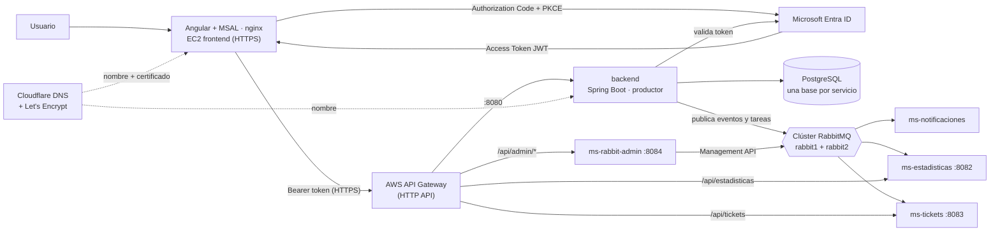

# EcoPunto · DSY1107 · Evaluaciones Parciales 1 a 4

**Asignatura:** DSY1107 · Desarrollo Cloud Native I · Sección 002D  
**Estudiante:** Jonathan Larraguibel

> **EP3 / EP4 · Mensajería asíncrona con RabbitMQ:** el backend publica eventos y tareas que
> procesan cuatro microservicios nuevos (notificaciones, estadísticas, tickets y administrador de
> RabbitMQ) sobre un clúster de 2 nodos. Documentación completa en
> [`docs/mensajeria.md`](docs/mensajeria.md) · despliegue: [`docs/despliegue-ep3.md`](docs/despliegue-ep3.md) ·
> guion de la demo: [`docs/guion-demo-ep4.md`](docs/guion-demo-ep4.md).

Sistema para consultar puntos limpios de reciclaje y reportar si un material ya no se puede depositar en un punto específico.

## Despliegue en producción

| Componente | URL |
|---|---|
| Frontend (Angular + MSAL) | https://ecopunto.larraguibel.dev |
| API (AWS API Gateway, HTTP API) | https://mld2c6mojh.execute-api.us-east-1.amazonaws.com |
| Ruta pública de ejemplo | https://mld2c6mojh.execute-api.us-east-1.amazonaws.com/public/puntos-limpios |
| RabbitMQ Management UI | http://ecopunto-api.larraguibel.dev:15672 (nodo 1) · :15673 (nodo 2) |

El backend no se expone directamente: se accede a través del API Gateway. Las instancias
corren en un laboratorio de AWS Academy, así que solo están disponibles mientras el
laboratorio está encendido. La configuración del frontend para producción
(`src/environments/environment.ts`, con `apiBaseUrl` apuntando al Gateway) no se versiona;
el repositorio incluye la plantilla `environment.example.ts`. Detalle del despliegue actual
(Elastic IPs, Security Groups, rutas del Gateway): [`docs/despliegue-ep3.md`](docs/despliegue-ep3.md).

## Presentación

| Evaluación | Archivo |
|---|---|
| EP4 · Mensajería con RabbitMQ en la nube | [`docs/presentacion/EcoPunto-EP4.pptx`](docs/presentacion/EcoPunto-EP4.pptx) |
| EP2 · Seguridad con Entra ID y API Gateway | [`docs/presentacion/EcoPunto-EP2.pptx`](docs/presentacion/EcoPunto-EP2.pptx) |

El guion de la demo EP4 está en [`docs/guion-demo-ep4.md`](docs/guion-demo-ep4.md).

## Arquitectura



Todo lo que está detrás del Gateway corre en la EC2 del backend con un único
`docker-compose.yml`. Exchanges `ecopunto.events` (topic), `ecopunto.tareas` (direct) y
`ecopunto.dlx`, con tres colas quorum y sus DLQ; detalle en [`docs/mensajeria.md`](docs/mensajeria.md).

## Estado

| Componente | Estado |
|---|---|
| `frontend/` — Angular + MSAL (login, guard, interceptor, CRUD por rol, reportes, tickets, estadísticas y administración de RabbitMQ) | ✅ Desplegado en AWS |
| `backend/` — Spring Boot Resource Server y productor de eventos | ✅ Valida JWT real (issuer/audience/firma/rol), publica con confirmaciones |
| Tenant / App Registration en Entra ID (roles `ENCARGADO` y `ADMIN`) | ✅ Configurado, login end-to-end verificado |
| AWS API Gateway (HTTP API, 12 rutas con JWT authorizer) | ✅ Funcionando, con CORS configurado |
| Mensajería RabbitMQ (EP3): productor + 4 microservicios, ACK manual, reintentos, DLQ, idempotencia | ✅ Desplegado en AWS con docker-compose |
| Clúster RabbitMQ de 2 nodos, colas quorum, exchanges direct y topic | ✅ Desplegado en AWS ([capturas](docs/evidencia/ep3-ep4/cluster-rabbitmq-aws.md)) |
| Pruebas de punta a punta del stack completo | ✅ 38 de 38 en local ([matriz](docs/evidencia/ep3-ep4/pruebas-locales.md)) y flujo con login real en producción ([evidencia](docs/evidencia/ep3-ep4/flujo-encargado.md)) |

## Entidades del dominio

```text
PuntoLimpio ── Reporte
```

```text
GET    /public/puntos-limpios            → público
GET    /api/puntos-limpios               → protegido, autenticado
POST   /api/puntos-limpios               → protegido, ROLE_ENCARGADO
PUT    /api/puntos-limpios/{id}          → protegido, ROLE_ENCARGADO
DELETE /api/puntos-limpios/{id}          → protegido, ROLE_ENCARGADO
GET    /api/puntos-limpios/{id}/reportes → protegido, scope reportes.read
POST   /api/puntos-limpios/{id}/reportes → protegido, scope reportes.write
PATCH  /api/reportes/{id}/estado         → protegido, ROLE_ENCARGADO (publica eventos en RabbitMQ)
GET    /api/estadisticas                 → ms-estadisticas, autenticado
GET    /api/tickets                      → ms-tickets, ROLE_ENCARGADO
*      /api/admin/{queues|exchanges|bindings} → ms-rabbit-admin, ROLE_ADMIN
```

## Estructura

```text
dsy1107-ep1-ecopunto/
├── README.md
├── docker-compose.yml   ← PostgreSQL + clúster RabbitMQ (2 nodos) + backend + 4 microservicios
├── .env.example         ← variables y secretos (copiar a .env)
├── infra/               ← configuración de RabbitMQ (clúster) y PostgreSQL (bases por servicio)
├── deploy/              ← DNS dinámico (ddns/) y datos sintéticos para la demo
├── docs/
│   ├── mensajeria.md        ← diseño e implementación de la mensajería (EP3/EP4)
│   ├── despliegue-ep3.md    ← despliegue en AWS del stack completo
│   ├── guion-demo-ep4.md    ← guion de la demo EP4
│   ├── presentacion/        ← presentaciones EP2 y EP4
│   └── evidencia/           ← evidencia por evaluación: ep2/ (presentación anterior) y ep3-ep4/ (actual)
├── frontend/            ← Angular 22 + @azure/msal-angular
├── backend/             ← Spring Boot 4 · Java 21 · Resource Server OAuth2/JWT · PRODUCTOR
├── ms-notificaciones/   ← consumidor: avisos de reportes creados y resueltos
├── ms-estadisticas/     ← consumidor: contadores por estado, comuna y punto
├── ms-tickets/          ← consumidor: tickets de mantención
└── ms-rabbit-admin/     ← API REST para administrar colas, exchanges y bindings
```

## Cómo correr el stack completo (EP3/EP4)

```bash
cp .env.example .env      # contraseñas, cookie de RabbitMQ, tenant/clientId, dominio del frontend
docker compose up -d --build
docker compose ps
```

Para probarlo en local sin cuentas de Entra ID, [`docs/evidencia/ep3-ep4/pruebas-locales/levantar.sh`](docs/evidencia/ep3-ep4/pruebas-locales/levantar.sh)
levanta el mismo stack con un emisor de JWT de prueba y [`pruebas.sh`](docs/evidencia/ep3-ep4/pruebas-locales/pruebas.sh)
ejecuta las 38 pruebas. Para que la demo no parta vacía, [`deploy/datos-sinteticos.py`](deploy/datos-sinteticos.py)
carga puntos limpios y reportes de ejemplo y publica sus eventos en RabbitMQ, así los
consumidores generan tickets, notificaciones y estadísticas por el flujo real.

## Cómo ejecutar el frontend

```bash
cd frontend
npm install
cp src/environments/environment.example.ts src/environments/environment.ts
# completar clientId, tenantId y apiScope con los valores reales del App Registration
npm start
```

## Cómo ejecutar el backend

```bash
cd backend
./mvnw spring-boot:run
```

Levanta en `http://localhost:8080` con base de datos H2 en memoria (se recrea y se
siembra con datos de prueba en cada arranque). Sin variables de entorno,
`issuer`/`audience`/`jwks-uri` quedan con valores por defecto que permiten que el
backend arranque, pero ningún token real va a pasar la validación — solo sirve para
probar las rutas públicas y el 401 en las protegidas. Para usar el tenant real:

```bash
export JWT_ISSUER=https://login.microsoftonline.com/<tenantId>/v2.0
export JWT_JWKS_URI=https://login.microsoftonline.com/<tenantId>/discovery/v2.0/keys
export JWT_AUDIENCE=<clientId>
```

> **Importante sobre `JWT_AUDIENCE`:** para tokens v2.0 emitidos contra la API propia
> (no Microsoft Graph), el claim `aud` viene como el Client ID "pelado" (el GUID),
> **sin** el prefijo `api://`. Si se pone `api://<clientId>` acá, la validación de
> audience falla siempre con 401 aunque el resto del token sea válido.
>
> Además, en el App Registration de Entra ID hay que forzar tokens v2 explícitamente:
> **Manifiesto → `"api": { "requestedAccessTokenVersion": 2 }`**. Por defecto queda en
> `null`, y Azure emite tokens v1.0 (`iss` con formato `https://sts.windows.net/<tenantId>/`)
> para APIs propias aunque todo el flujo de login use el endpoint v2 — es un detalle de
> compatibilidad hacia atrás con ADAL que rompe silenciosamente la validación de issuer
> si no se cambia.

## Evidencia de autorización (matriz de seguridad)

Probado end-to-end contra el tenant real de Entra ID, con dos usuarios de prueba
(uno con el rol `ENCARGADO` asignado y otro sin ningún rol):

| Escenario | Resultado |
|---|---|
| `GET /public/puntos-limpios` sin token | 200 |
| `GET /api/puntos-limpios` sin token | 401 |
| `PUT`/`POST`/`DELETE /api/puntos-limpios` sin token | 401 |
| `GET /api/puntos-limpios` con token válido, sin rol `ENCARGADO` | 200 (solo exige autenticación) |
| `PUT`/`POST`/`DELETE /api/puntos-limpios` con token válido, sin rol `ENCARGADO` | 403 |
| `PUT`/`POST`/`DELETE /api/puntos-limpios` con token válido y rol `ENCARGADO` | 200/201/204 |

**Verificado también en el despliegue real de AWS** (frontend en EC2 → API Gateway →
backend en EC2, ejecutado desde el navegador con el origen real), con los mismos dos
usuarios:

| Escenario | Resultado |
|---|---|
| Público sin token / protegido sin token | 200 / 401 |
| Usuario sin rol: lectura (`GET` puntos y reportes) | 200 |
| Usuario sin rol: `POST` / `PUT` / `DELETE` | 403 |
| Usuario `ENCARGADO`: `POST` / `PUT` / `DELETE` | 201 / 200 / 204 |
| Usuario `ENCARGADO`: `DELETE` de un id inexistente | 404 |

Detalle con los claims de cada token en [`docs/evidencia/ep2/matriz-seguridad.md`](docs/evidencia/ep2/matriz-seguridad.md);
el script [`docs/evidencia/ep2/probar-matriz.js`](docs/evidencia/ep2/probar-matriz.js) permite repetir la prueba
pegándolo en la consola del navegador con una sesión iniciada. Evidencia visual del
comportamiento de la UI según el rol: [`docs/evidencia/ep2/usuario-sin-rol.md`](docs/evidencia/ep2/usuario-sin-rol.md)
(registro de autoservicio, sin botones de edición) y [`docs/evidencia/ep2/usuario-encargado.md`](docs/evidencia/ep2/usuario-encargado.md)
(CRUD completo habilitado). Configuración en consola de AWS API Gateway y Microsoft
Entra ID en [`docs/evidencia/ep2/api-gateway-y-entra.md`](docs/evidencia/ep2/api-gateway-y-entra.md).

**EP3/EP4:** evidencia en [`docs/evidencia/ep3-ep4/`](docs/evidencia/ep3-ep4/), con el mismo formato que la de EP2:
el recorrido en producción con login real ([`flujo-encargado.md`](docs/evidencia/ep3-ep4/flujo-encargado.md)), el
administrador de RabbitMQ ([`administrador-rabbitmq.md`](docs/evidencia/ep3-ep4/administrador-rabbitmq.md)), el clúster en
AWS ([`cluster-rabbitmq-aws.md`](docs/evidencia/ep3-ep4/cluster-rabbitmq-aws.md)), las rutas del API Gateway
([`api-gateway.md`](docs/evidencia/ep3-ep4/api-gateway.md)) y la matriz de 38 pruebas en local
([`pruebas-locales.md`](docs/evidencia/ep3-ep4/pruebas-locales.md)). Índice completo en [`docs/evidencia/`](docs/evidencia/).

Nota sobre permisos: los scopes delegados (`reportes.read`/`reportes.write`) se
rigen por **consentimiento** — el consentimiento de administrador otorgado una
vez en el App Registration aplica a todos los usuarios del tenant automáticamente.
El App Role (`ENCARGADO`) se rige por **asignación explícita** por usuario/grupo
en Enterprise Applications, independiente del consentimiento de scopes — por eso
un usuario sin el rol asignado igual trae los scopes en su token, pero no el rol.

## Cómo correr con Docker

Cada componente tiene su propio `Dockerfile` (build multi-stage, sin dependencias de
Maven/Node en el host más que Docker mismo).

```bash
# backend (compila con el wrapper adentro del contenedor, corre en :8080)
cd backend
docker build -t ecopunto-backend .
docker run --rm -p 8080:8080 \
  -e ALLOWED_ORIGINS=https://<dominio-frontend> \
  -e JWT_ISSUER=https://login.microsoftonline.com/<tenantId>/v2.0 \
  -e JWT_JWKS_URI=https://login.microsoftonline.com/<tenantId>/discovery/v2.0/keys \
  -e JWT_AUDIENCE=<clientId> \
  ecopunto-backend

# frontend (build de producción servido con nginx, HTTPS en :443,
# redirect automático desde :80)
cd frontend
docker build -t ecopunto-frontend .
docker run --rm -p 80:80 -p 443:443 \
  -v ~/certs:/etc/nginx/certs:ro \
  ecopunto-frontend
```

Si no se pasan variables de entorno al backend, arranca igual con los valores por
defecto (ver sección anterior) — útil para probar el contenedor localmente antes de
tener el tenant real.

## Despliegue en AWS (EP2)

> Esta sección describe el despliegue de la EP2 (backend solo en un contenedor). Desde la
> EP3 el backend corre en un stack `docker-compose` con PostgreSQL, el clúster RabbitMQ y
> los microservicios, y el Gateway tiene rutas para cada uno: ver [`docs/despliegue-ep3.md`](docs/despliegue-ep3.md).

```text
Navegador → https://<dominio-frontend>            (nginx en EC2, certificado Let's Encrypt)
          → https://<api-id>.execute-api.<region>.amazonaws.com   (API Gateway, HTTP API)
          → http://<dominio-backend>:8080         (Spring Boot en EC2, contenedor Docker)
```

- **Dos instancias EC2** (Amazon Linux 2023 con Docker y git): una para el frontend
  (puertos 80/443 abiertos en el Security Group) y otra para el backend (puerto 8080).
- **DNS en Cloudflare**, con dos registros `A` en modo **DNS only** (sin proxy): uno por
  cada instancia. Los certificados, el redirect URI de Entra ID, `ALLOWED_ORIGINS` y la
  integración del Gateway usan estos *nombres*, no las IPs.
- **API Gateway (HTTP API)** con estas rutas:

  | Ruta | Autorización | Integración |
  |---|---|---|
  | `ANY /public/{proxy+}` | ninguna | `http://<dominio-backend>:8080/public/{proxy}` |
  | `GET /api/{proxy+}` | JWT authorizer | `http://<dominio-backend>:8080/api/{proxy}` |
  | `POST /api/{proxy+}` | JWT authorizer | ídem |
  | `PUT /api/{proxy+}` | JWT authorizer | ídem |
  | `DELETE /api/{proxy+}` | JWT authorizer | ídem |

  El **JWT authorizer** valida en el propio Gateway la firma, la vigencia, el issuer
  (`https://login.microsoftonline.com/<tenantId>/v2.0`) y el audience (Client ID) del
  token, y responde 401 sin llegar al backend si algo falla. El backend vuelve a validar
  el token y aplica la autorización por rol (403), como defensa en profundidad.
- **CORS** configurado en el Gateway: origen = dominio del frontend, headers
  `authorization` y `content-type`, métodos `GET, POST, PUT, DELETE, OPTIONS`.
  Las rutas protegidas usan métodos explícitos y no `ANY` a propósito: `ANY` incluye
  `OPTIONS`, y el preflight del navegador (que no lleva token) chocaría con el
  authorizer. Sin ruta que coincida con `OPTIONS`, el Gateway responde el preflight
  directamente con la configuración de CORS.
- El `apiBaseUrl` del frontend (`src/environments/environment.ts`, no versionado) apunta a
  la URL de invocación del Gateway y queda compilado dentro del bundle, así que cambiarlo
  requiere reconstruir la imagen del frontend.

### Base de datos (PostgreSQL)

En la instancia del backend corre un contenedor `postgres:16-alpine` con un volumen
persistente, en una red interna de Docker compartida con el backend (el puerto 5432 no
se expone a Internet). El backend no necesita cambios de código: toma la conexión de
`DB_URL`, `DB_USER` y `DB_PASSWORD`, Hibernate crea las tablas (`ddl-auto: update`) y
los datos de ejemplo se cargan solo si la base está vacía. Sin esas variables usa H2 en
memoria, para desarrollo local.

```bash
# credenciales generadas en el propio servidor, fuera del repo
PASS=$(openssl rand -hex 24)
cat > ~/.ecopunto-db.env <<EOF
POSTGRES_DB=ecopunto
POSTGRES_USER=ecopunto
POSTGRES_PASSWORD=$PASS
DB_URL=jdbc:postgresql://ecopunto-db:5432/ecopunto
DB_USER=ecopunto
DB_PASSWORD=$PASS
EOF
chmod 600 ~/.ecopunto-db.env

docker network create ecopunto-net
docker run -d --name ecopunto-db --restart unless-stopped --network ecopunto-net \
  --env-file ~/.ecopunto-db.env -v ecopunto-pgdata:/var/lib/postgresql/data \
  postgres:16-alpine

docker run -d --name ecopunto-backend --restart unless-stopped --network ecopunto-net \
  -p 8080:8080 --env-file ~/.ecopunto-db.env \
  -e ALLOWED_ORIGINS=https://<dominio-frontend> \
  -e JWT_ISSUER=https://login.microsoftonline.com/<tenantId>/v2.0 \
  -e JWT_JWKS_URI=https://login.microsoftonline.com/<tenantId>/discovery/v2.0/keys \
  -e JWT_AUDIENCE=<clientId> \
  ecopunto-backend
```

### Por qué el frontend necesita HTTPS

MSAL usa `crypto.subtle` del navegador para PKCE, y los navegadores solo exponen esa
API en un **contexto seguro**: `https://` o `http://localhost`. Servir el frontend por
HTTP plano desde una IP pública hace que MSAL falle con `crypto_nonexistent` y la app
quede en blanco, sin más error que el de la consola del navegador. Además, una página
HTTPS no puede llamar a un backend HTTP (contenido mixto): por eso el backend se expone
a través del API Gateway, que ya publica HTTPS.

### Certificado del frontend (Let's Encrypt)

Con el registro `A` del dominio apuntando a la instancia y el puerto 80 libre:

```bash
docker run --rm -p 80:80 -v /etc/letsencrypt:/etc/letsencrypt certbot/certbot certonly \
  --standalone -d <dominio-frontend> --non-interactive --agree-tos \
  --register-unsafely-without-email
mkdir -p ~/certs
sudo cp -L /etc/letsencrypt/live/<dominio-frontend>/fullchain.pem ~/certs/
sudo cp -L /etc/letsencrypt/live/<dominio-frontend>/privkey.pem ~/certs/
sudo chown $USER ~/certs/*.pem
```

El certificado se monta en el contenedor de nginx (`-v ~/certs:/etc/nginx/certs:ro`) y
no se versiona. Dura 90 días y hay que renovarlo repitiendo el comando.

### Configuración necesaria en Entra ID

En el App Registration hay que agregar `https://<dominio-frontend>` como Redirect URI de
tipo **Single-page application**, sin barra final (Azure compara el texto exacto), además
de `http://localhost:4200` para el desarrollo local; si no, el login falla con
`redirect_uri_mismatch`.

### Al reiniciar el laboratorio (AWS Academy)

> Desde la EP3 las dos instancias tienen **Elastic IP**, así que la IP ya no cambia y el
> DNS dinámico queda como alternativa (ver [`docs/despliegue-ep3.md`](docs/despliegue-ep3.md)).

Sin Elastic IP, las IPs públicas cambian al detener y volver a iniciar las instancias. Como todo lo demás
usa nombres de dominio, lo único que depende de la IP son los dos registros `A` de
Cloudflare, y **se actualizan solos**: cada instancia corre un servicio de DNS dinámico
([`deploy/ddns/`](deploy/ddns/)) que al arrancar, y cada 5 minutos, lee su IP pública y
actualiza su registro por la API de Cloudflare. Los contenedores tienen
`--restart unless-stopped` y arrancan solos con la instancia, así que reiniciar el
laboratorio no requiere ningún paso manual.

#### Instalación del DNS dinámico (una vez por instancia)

1. En Cloudflare, crear un token de API con permiso **Zone → DNS → Edit** limitado a la
   zona del dominio, y anotar el **Zone ID** (pestaña Overview del dominio).
2. Crear en la instancia el archivo `/etc/ecopunto-ddns.env` (permisos `600`, solo root),
   con el registro que corresponde a esa instancia:

   ```bash
   CF_API_TOKEN=<token>
   CF_ZONE_ID=<zone-id>
   DDNS_RECORD=<dominio-de-esta-instancia>
   ```

3. Instalar el servicio desde el repo clonado en la instancia:

   ```bash
   cd deploy/ddns && sudo bash install.sh
   ```

El token no se versiona ni se comparte: vive únicamente en ese archivo de cada instancia.
