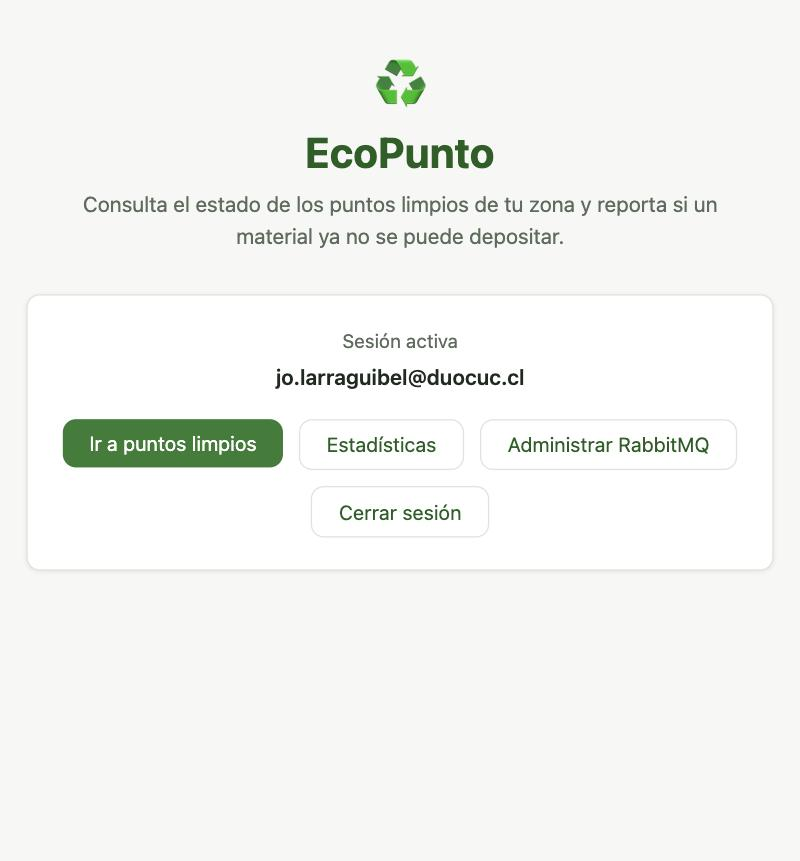
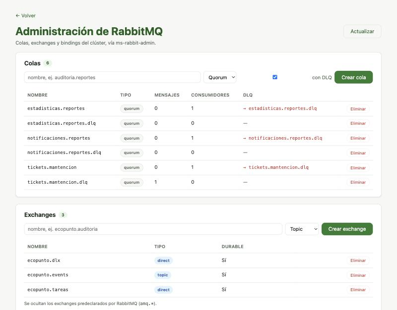
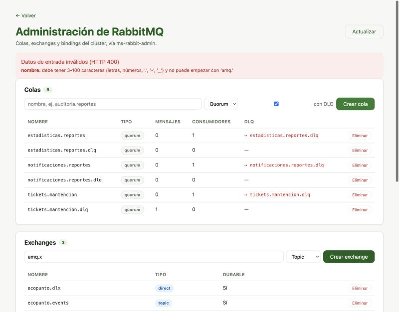
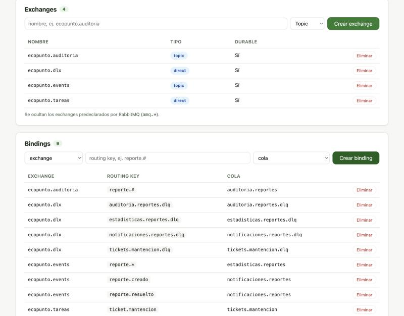
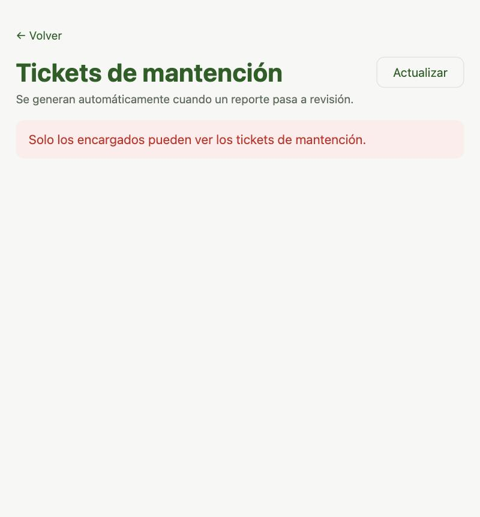

# Evidencia · Administrador de RabbitMQ (rol ADMIN)

Uso en **producción** de `ms-rabbit-admin` desde el frontend, con
`jo.larraguibel@duocuc.cl`: usuario con el App Role `ADMIN` en Entra ID y **sin**
`ENCARGADO`. La página *Administrar RabbitMQ* consume la API REST del microservicio a través
del API Gateway; toda la lógica de administración está en `RabbitAdminService`.

- **Fecha:** 2026-10-23
- **Frontend:** https://ecopunto.larraguibel.dev/admin-rabbitmq
- **API:** `/api/admin/{queues|exchanges|bindings}` vía API Gateway → `ms-rabbit-admin` (`:8084`)

## 1 · Sesión activa con rol ADMIN

El inicio muestra *Administrar RabbitMQ* y no muestra *Tickets de mantención*: los botones
dependen de los roles del token, y este usuario tiene `ADMIN` pero no `ENCARGADO`.



## 2 · Topología real del clúster

La página lista lo que existe en el clúster: las 6 colas quorum con sus mensajes,
consumidores y la DLQ a la que envía cada una (en rojo), y los 3 exchanges del sistema. Se
ocultan los exchanges predeclarados por RabbitMQ (`amq.*`).



## 3 · Validación de entrada (400)

Al intentar crear un exchange con el nombre reservado `amq.x`, la API responde **400** y la
página muestra el error del campo `nombre` que devuelve el DTO validado.



## 4 · Crear exchange, cola con DLQ y binding

Se creó el exchange `ecopunto.auditoria` (topic), la cola `auditoria.reportes` (quorum, con
DLQ) y el binding `ecopunto.auditoria --reporte.#--> auditoria.reportes`. La DLQ
`auditoria.reportes.dlq` y su binding a `ecopunto.dlx` se crean automáticamente. Después
se eliminó todo y el broker volvió a su estado original (6 colas, 3 exchanges, 7 bindings).



Cada operación queda registrada por `ms-rabbit-admin` con el correo del usuario:

```text
03:47:15 [ADMIN] jo.larraguibel@duocuc.cl creó el exchange ecopunto.auditoria (tipo=TOPIC)
03:47:22 [ADMIN] jo.larraguibel@duocuc.cl creó la cola auditoria.reportes (tipo=QUORUM, conDlq=true)
03:47:28 [ADMIN] jo.larraguibel@duocuc.cl creó el binding ecopunto.auditoria --reporte.#--> auditoria.reportes
03:47:43 [ADMIN] jo.larraguibel@duocuc.cl eliminó el binding ecopunto.auditoria --reporte.#--> auditoria.reportes
03:47:52 [ADMIN] jo.larraguibel@duocuc.cl eliminó la cola auditoria.reportes (forzar=false)
03:47:55 [ADMIN] jo.larraguibel@duocuc.cl eliminó la cola auditoria.reportes.dlq (forzar=false)
03:47:57 [ADMIN] jo.larraguibel@duocuc.cl eliminó el exchange ecopunto.auditoria
```

## 5 · Autorización por rol (403)

El mismo usuario intenta abrir *Tickets de mantención*. El token es válido para el API
Gateway, pero `ms-tickets` exige `ENCARGADO` y responde **403**; el frontend lo muestra
como mensaje.



## API del administrador

| Escenario | Esperado | Obtenido |
|---|---:|---:|
| Listar colas con rol `ADMIN` | 200 | 200 |
| Listar colas sin rol `ADMIN` | 403 | 403 |
| Crear exchange con nombre `amq.x` / cola con nombre vacío | 400 | 400 |
| Crear exchange, cola con DLQ y binding | 201 | 201 |
| Crear una cola o binding que ya existe | 409 | 409 |
| Binding hacia una cola inexistente | 404 | 404 |
| Eliminar una cola con consumidor sin `forzar=true` | 409 | 409 |
| Eliminar binding, colas y exchange | 204 | 204 |

La matriz completa, repetible en local, está en [`pruebas-locales.md`](./pruebas-locales.md) (pruebas 25 a 38).
