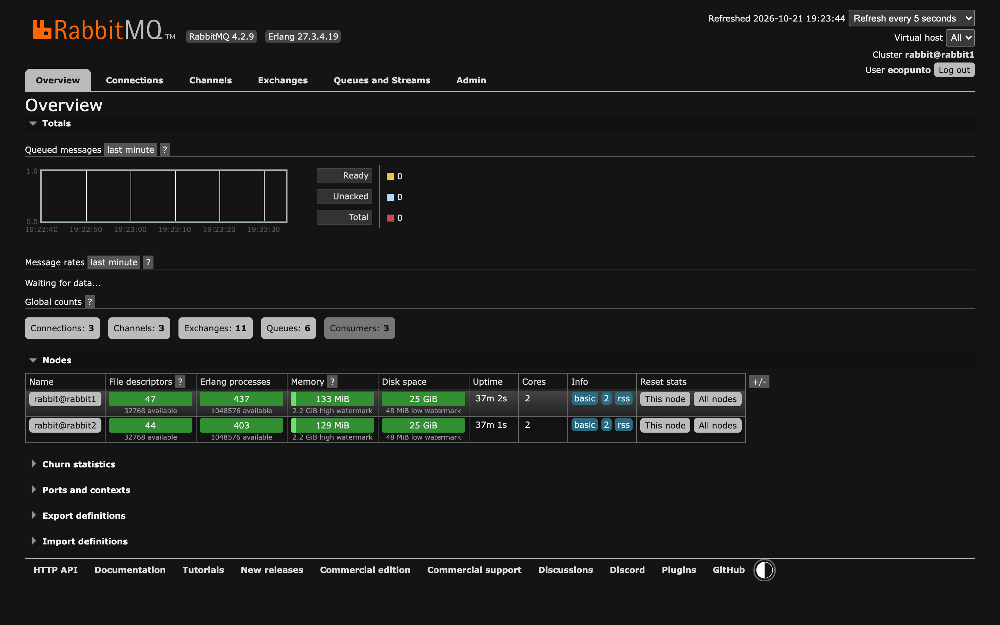
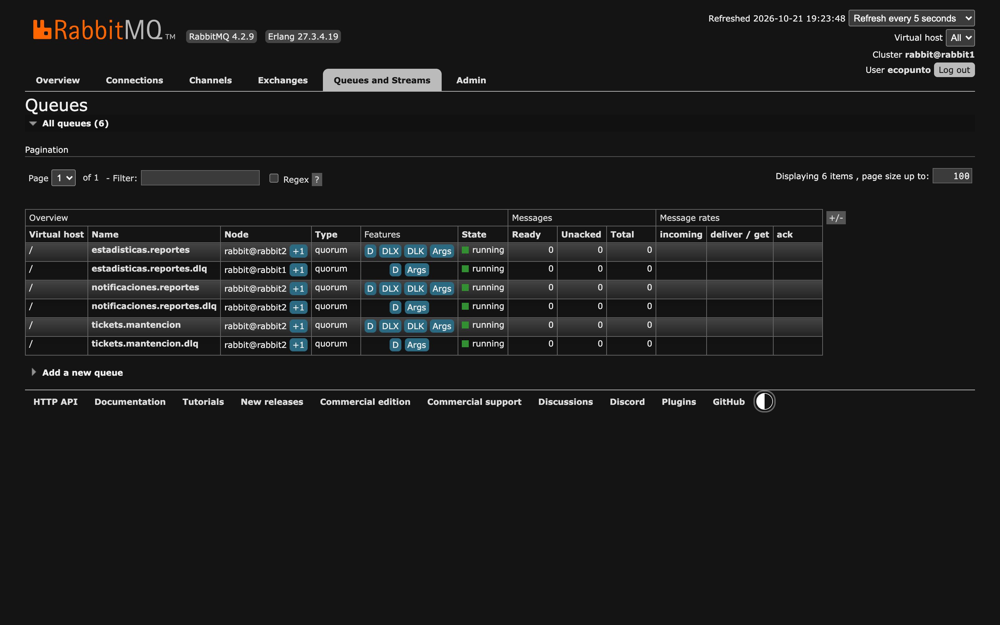
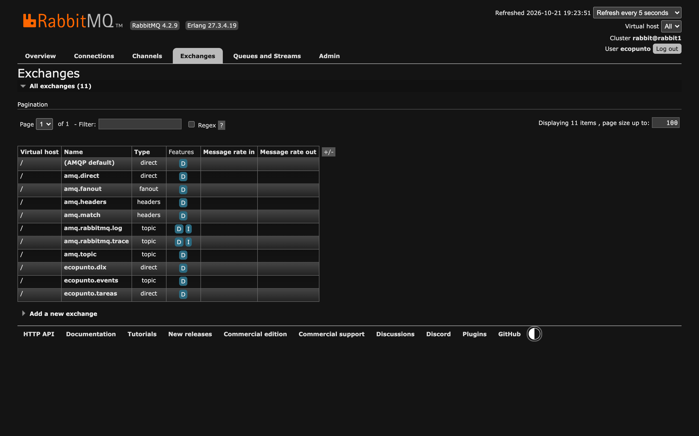
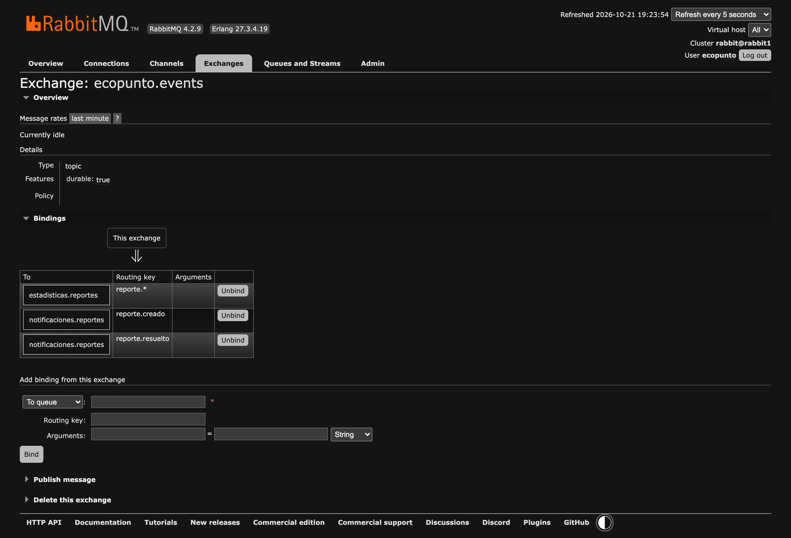
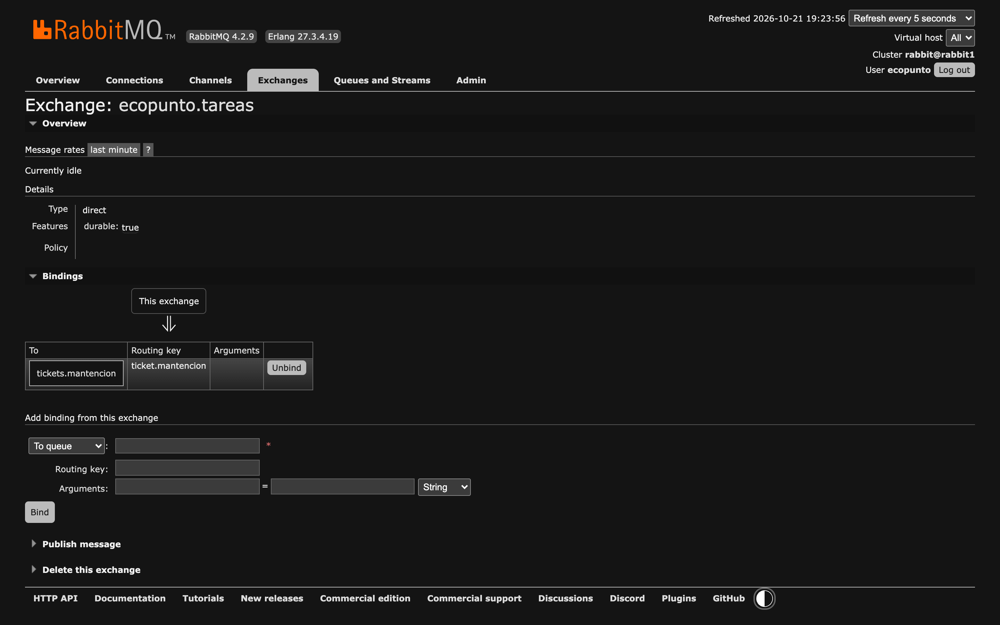
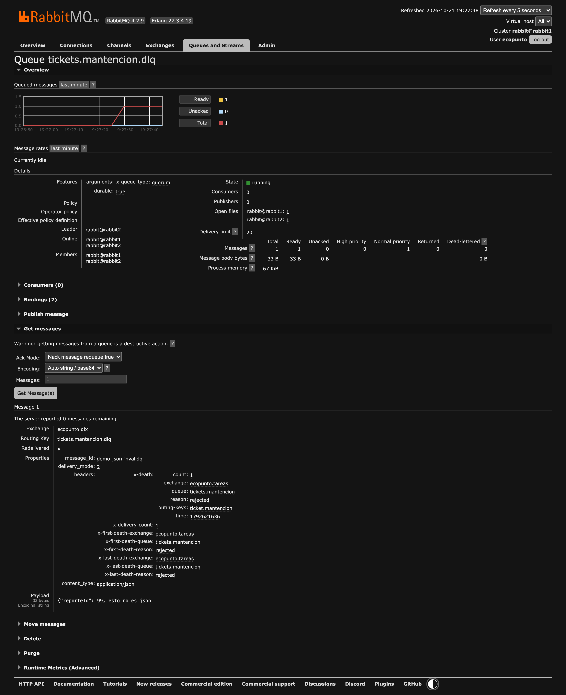

# Evidencia · Clúster RabbitMQ en AWS

Capturas del Management UI de RabbitMQ en la EC2 `ecopunto-backend`, donde `docker-compose`
levanta el clúster de dos nodos junto con PostgreSQL, el backend y los cuatro
microservicios. No incluye contraseñas ni secretos.

- **Fecha:** 2026-10-21
- **Instancia:** EC2 `ecopunto-backend` (`t3.medium`), Elastic IP, dominio `ecopunto-api.larraguibel.dev`
- **Management UI:** `http://ecopunto-api.larraguibel.dev:15672` (nodo 1) y `:15673` (nodo 2)

## 1 · Dos nodos en clúster

`rabbit@rabbit1` y `rabbit@rabbit2` en ejecución dentro del mismo clúster, con las 6 colas y
los 3 consumidores conectados (uno por microservicio consumidor).

## 2 · Tres colas, cada una con su DLQ

Las colas `notificaciones.reportes`, `estadisticas.reportes` y `tickets.mantencion` son de
tipo **quorum** (replicadas entre los dos nodos). Cada una tiene configurado un `DLX`
(`ecopunto.dlx`) y un `DLK` que lleva los mensajes fallidos a su propia `*.dlq`.

## 3 · Exchanges direct y topic

- `ecopunto.events` (**topic**): eventos de reportes, con varios interesados filtrados por patrón.
- `ecopunto.tareas` (**direct**): tareas para un único tipo de trabajador (tickets).
- `ecopunto.dlx` (**direct**): recibe los mensajes rechazados y los envía a la DLQ que corresponde.

## 4 · Bindings del exchange topic

`reporte.creado` y `reporte.resuelto` van a `notificaciones.reportes`; el patrón `reporte.*`
envía todos los eventos de reportes a `estadisticas.reportes`.

## 5 · Binding del exchange direct

La routing key exacta `ticket.mantencion` lleva las tareas a `tickets.mantencion`.

## 6 · Mensaje rechazado en la DLQ

Se publicó en `ecopunto.tareas` un mensaje con JSON inválido. ms-tickets lo rechaza sin
reintentar (`[DLQ] motivo=NO_RECUPERABLE`) y queda en `tickets.mantencion.dlq`, con el
header `x-death` que indica la cola de origen y el motivo (`rejected`).

## Relación con la pauta oficial de EP4

| Punto de la pauta | Evidencia |
|---|---|
| Dos nodos RabbitMQ configurados e integrados en un clúster | 1 · Dos nodos en clúster |
| Tres colas de mensajes con sus respectivas DLQ funcionando | 2 · Tres colas, cada una con su DLQ + 6 · Mensaje rechazado en la DLQ |
| Exchanges de tipo direct y topic correctamente configurados | 3 · Exchanges + 4 y 5 · Bindings |
| Ejecución de docker-compose levantando RabbitMQ en la nube | Este mismo Management UI corre en la EC2 levantada con `docker compose up -d` ([`despliegue-ep3.md`](../../despliegue-ep3.md)) |
