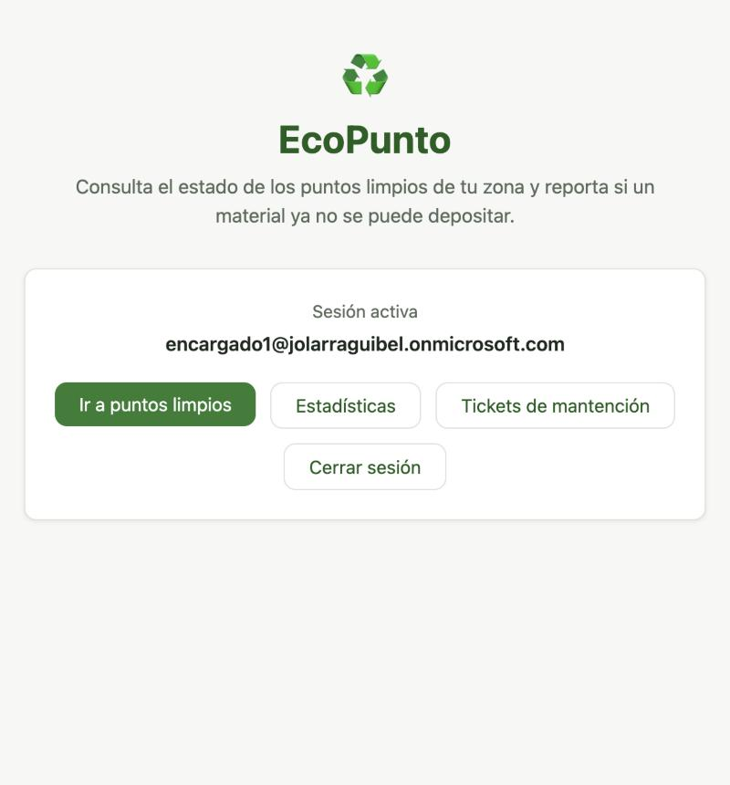
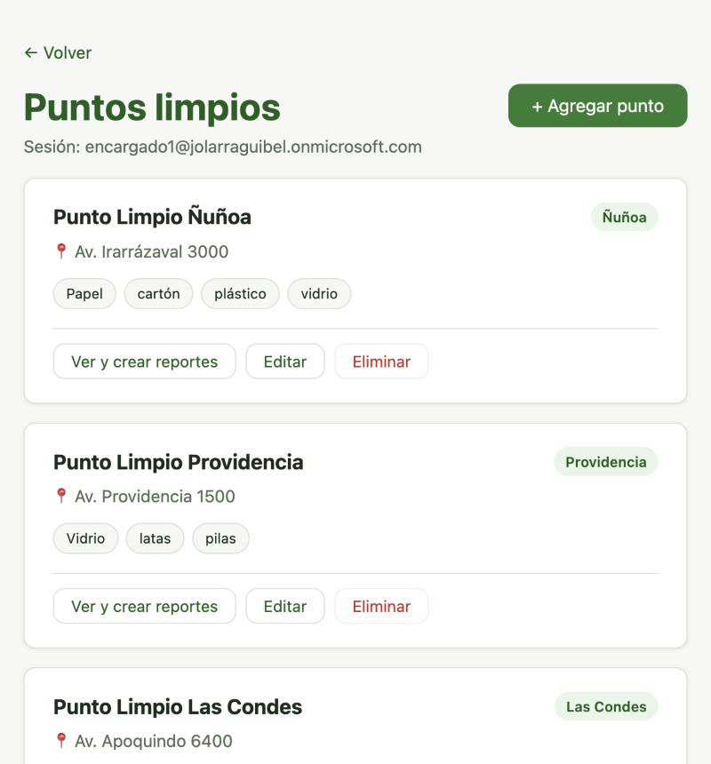
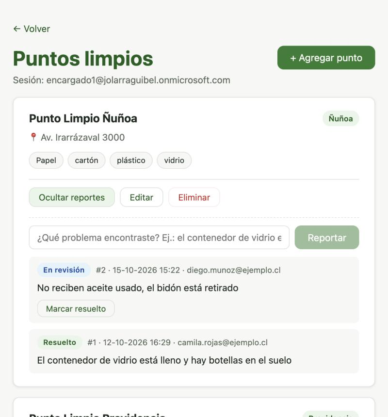
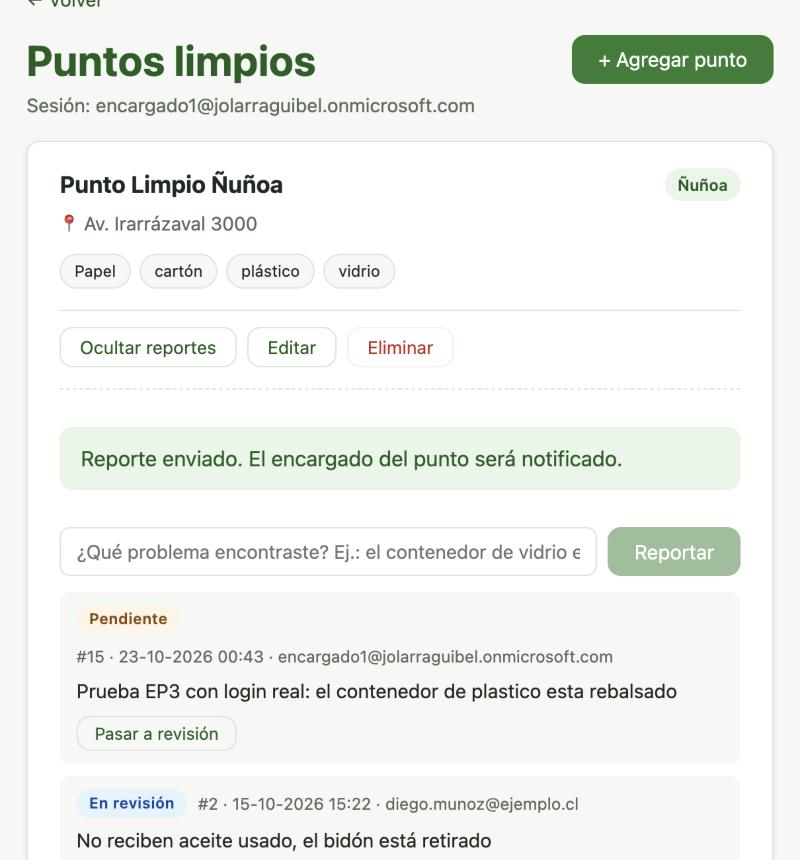
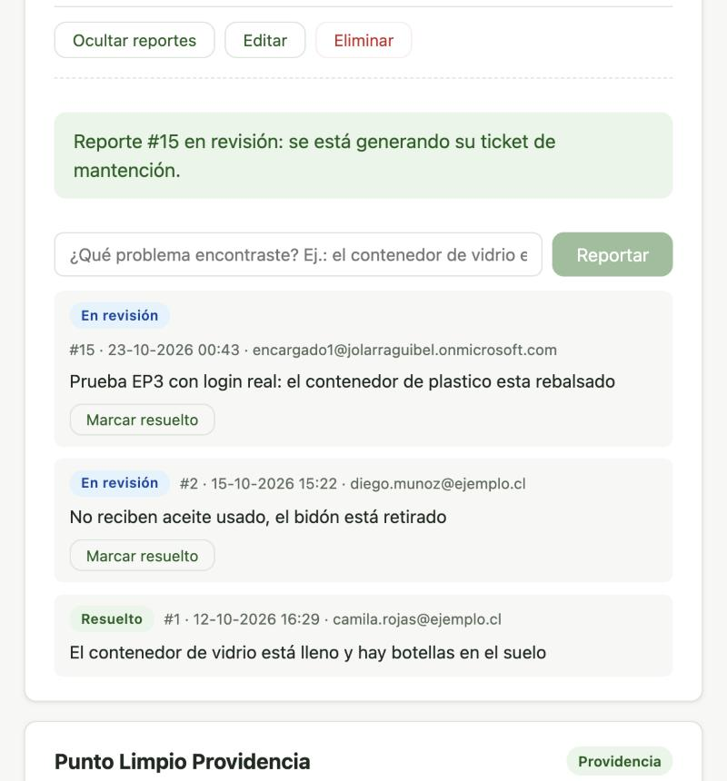
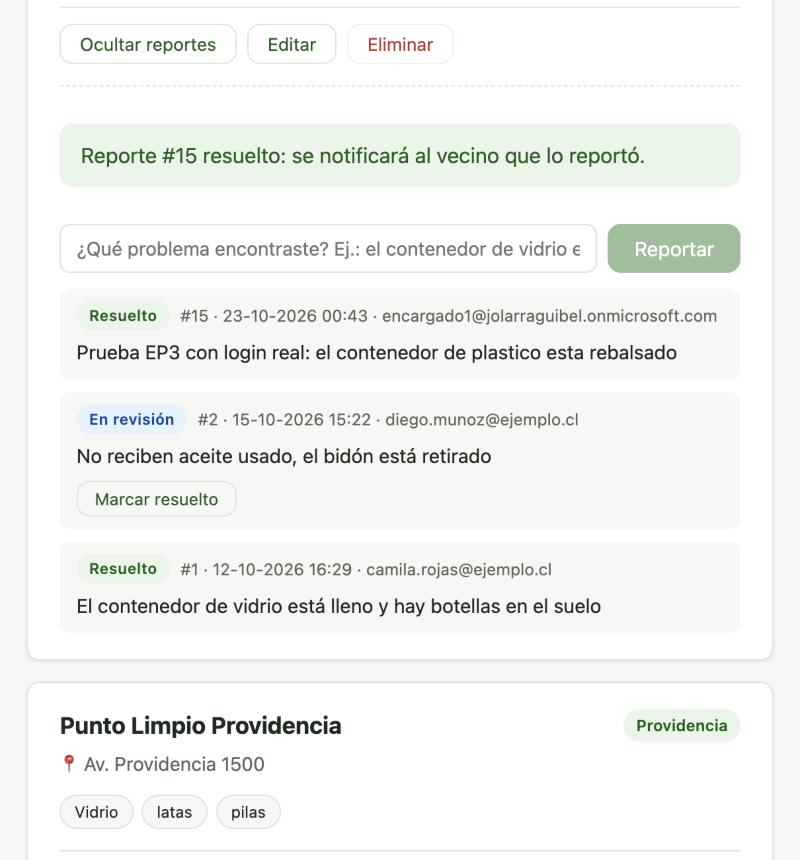
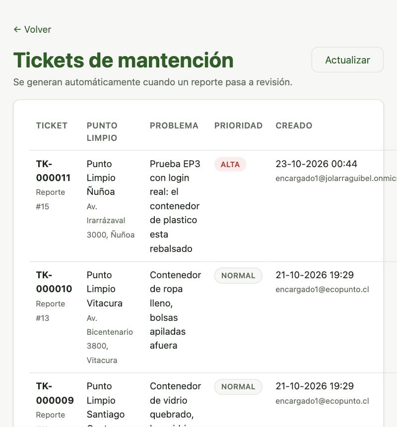
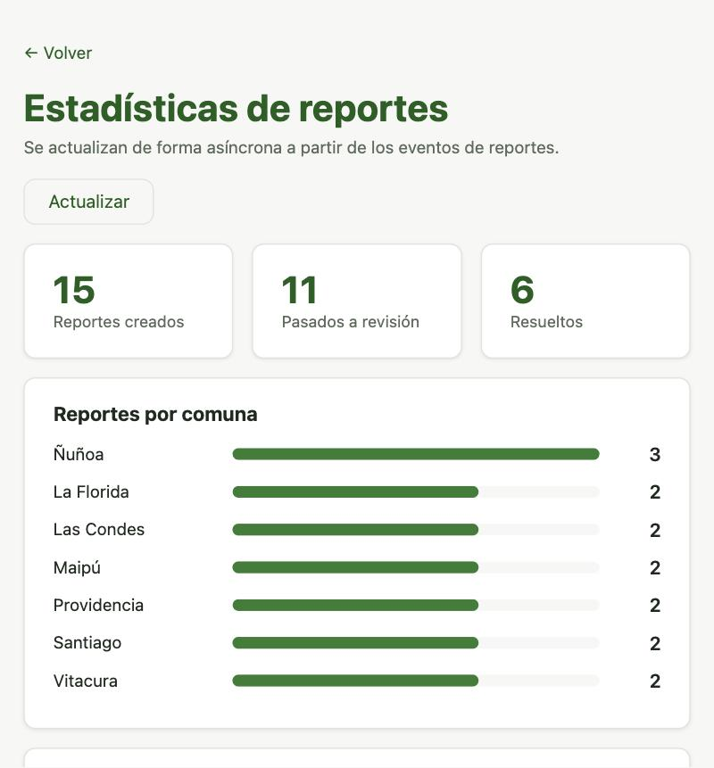

# Evidencia · Flujo de reportes con mensajería (rol ENCARGADO)

Recorrido completo en **producción** con `encargado1@jolarraguibel.onmicrosoft.com`, el
usuario con el App Role `ENCARGADO` en Entra ID. Cada acción del frontend pasa por el API
Gateway (que valida el JWT) y llega al backend, que publica eventos y tareas en RabbitMQ;
los microservicios consumidores hacen el resto de forma asíncrona.

- **Fecha:** 2026-10-23
- **Frontend:** https://ecopunto.larraguibel.dev (EC2 `ecopunto-frontend`)
- **API:** `https://mld2c6mojh.execute-api.us-east-1.amazonaws.com` → EC2 `ecopunto-backend` (stack `docker-compose`)
- **Login:** Authorization Code + PKCE contra el tenant real de Entra ID

## 1 · Sesión activa

El inicio muestra los botones según los roles del token: *Estadísticas* y *Tickets de
mantención* (rol `ENCARGADO`). No aparece *Administrar RabbitMQ*, porque `encargado1` no
tiene el rol `ADMIN`.



## 2 · Listado de puntos limpios

Los 7 puntos limpios, con los controles de encargado (*Editar*, *Eliminar*, *+ Agregar
punto*) y el botón nuevo *Ver y crear reportes* en cada tarjeta.



## 3 · Reportes de un punto

Al abrir los reportes del Punto Limpio Ñuñoa se ve cada reporte con su estado y, para el
encargado, el botón que avanza al estado siguiente (`PENDIENTE → EN_REVISION → RESUELTO`).



## 4 · Crear un reporte (POST → evento `reporte.creado`)

Se crea el reporte **#15**, que queda `PENDIENTE`.



El backend guarda el reporte y, después del commit, publica `ReporteCreadoEvent` en el
exchange topic `ecopunto.events`. El evento llega a dos colas distintas y cada consumidor
confirma con ACK:

```text
03:43:58.403 backend           [PUBLISH] ReporteCreadoEvent -> exchange=ecopunto.events routingKey=reporte.creado
03:43:58.451 backend           [PUBLISH-CONFIRM] broker confirmó messageId=92b5f4e1-…
03:44:00.211 ms-estadisticas   [ESTADISTICAS] evento=92b5f4e1-… tipo=creado punto="Punto Limpio Ñuñoa" comuna=Ñuñoa
03:44:00.276 ms-notificaciones [NOTIFICACION] para=encargados@ecopunto.cl | asunto="Nuevo reporte #15 en Punto Limpio Ñuñoa"
03:44:00.302 ms-notificaciones [ACK] cola=notificaciones.reportes messageId=92b5f4e1-… intento=1
03:44:00.314 ms-estadisticas   [ACK] cola=estadisticas.reportes messageId=92b5f4e1-… intento=1
```

## 5 · Pasar a revisión (PATCH → evento + tarea de ticket)

El encargado pasa el reporte a `EN_REVISION`. La interfaz avisa que se está generando el
ticket, sin esperar a que termine.



El backend publica dos mensajes: el evento `reporte.en_revision` en el exchange **topic**
y la tarea `ticket.mantencion` en el exchange **direct** `ecopunto.tareas`, que consume
ms-tickets:

```text
03:44:18.713 backend           [PUBLISH] ReporteEstadoCambiadoEvent -> exchange=ecopunto.events routingKey=reporte.en_revision
03:44:18.727 backend           [PUBLISH] GenerarTicketMantencionCommand -> exchange=ecopunto.tareas routingKey=ticket.mantencion
03:44:18.756 ms-estadisticas   [ACK] cola=estadisticas.reportes messageId=1d027091-… intento=1
03:44:19.822 ms-tickets        [TICKET] generado TK-000011 para reporte 15 | Punto Limpio Ñuñoa (Ñuñoa) | prioridad ALTA
03:44:19.845 ms-tickets        [ACK] cola=tickets.mantencion messageId=ec49d6e2-… intento=1
```

## 6 · Marcar resuelto (PATCH → evento `reporte.resuelto`)

El reporte pasa a `RESUELTO` y se notifica al vecino que lo creó.



```text
03:44:27.373 backend           [PUBLISH] ReporteEstadoCambiadoEvent -> exchange=ecopunto.events routingKey=reporte.resuelto
03:44:27.409 ms-notificaciones [NOTIFICACION] para=encargado1@jolarraguibel.onmicrosoft.com | asunto="Tu reporte #15 fue resuelto"
03:44:27.418 ms-notificaciones [ACK] cola=notificaciones.reportes messageId=4e8c64c8-… intento=1
03:44:27.428 ms-estadisticas   [ACK] cola=estadisticas.reportes messageId=4e8c64c8-… intento=1
```

## 7 · Tickets de mantención (ms-tickets)

El ticket **`TK-000011`** aparece primero, asociado al reporte #15 y con prioridad
**ALTA**, porque la descripción menciona "rebalsado". Los demás tickets vienen de los datos
de demostración, generados por el mismo flujo.



## 8 · Estadísticas (ms-estadisticas)

Los contadores incluyen el reporte #15: 15 creados, 11 pasados a revisión y 6 resueltos,
con Ñuñoa a la cabeza. La página llama a `GET /api/estadisticas` a través del Gateway, que
responde **200**.



## Conclusión

Con una sola acción del usuario, el backend responde de inmediato y delega en RabbitMQ:

| Acción | Publicado | Exchange (tipo) | Consumidores | Resultado |
|---|---|---|---|---|
| Crear reporte | `reporte.creado` | `ecopunto.events` (topic) | notificaciones, estadísticas | Aviso a encargados, contadores |
| Pasar a revisión | `reporte.en_revision` + `ticket.mantencion` | topic + `ecopunto.tareas` (direct) | estadísticas, tickets | `TK-000011` prioridad ALTA |
| Marcar resuelto | `reporte.resuelto` | `ecopunto.events` (topic) | notificaciones, estadísticas | Aviso al autor del reporte |

Todos los mensajes terminan con `[ACK]` del consumidor, después de procesarse.
