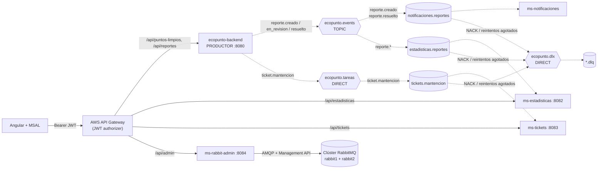

# EcoPunto · Mensajería asíncrona con RabbitMQ (EP3 / EP4)

Esta etapa incorpora RabbitMQ a EcoPunto **sin modificar la lógica existente**: el backend de EP1/EP2 sigue resolviendo puntos limpios y reportes, y ahora además **publica eventos y tareas** que procesan cuatro microservicios nuevos de forma desacoplada.

## 1. Arquitectura



| Componente | Puerto | Responsabilidad | Rol en mensajería | Base de datos |
|---|---|---|---|---|
| `backend` (existente) | 8080 | Puntos limpios y reportes; cambio de estado del reporte | **Productor** | `ecopunto` |
| `ms-notificaciones` | — | Avisa al encargado (reporte nuevo) y al vecino (reporte resuelto) | Consumidor | `ecopunto_notificaciones` |
| `ms-estadisticas` | 8082 | Contadores por estado, comuna y punto; `GET /api/estadisticas` | Consumidor | `ecopunto_estadisticas` |
| `ms-tickets` | 8083 | Genera tickets de mantención; `GET /api/tickets` | Consumidor | `ecopunto_tickets` |
| `ms-rabbit-admin` | 8084 | API REST para crear y eliminar colas, exchanges y bindings | Administrador | — |
| `rabbit1`, `rabbit2` | 5672 / 15672 | Clúster RabbitMQ de 2 nodos con Management UI | Broker | — |

Cada microservicio es dueño de su propia base de datos (bases separadas en el mismo PostgreSQL).

## 2. Casos de uso asíncronos

| # | Gatillante | Exchange (tipo) | Routing key | Cola → consumidor | Resultado |
|---|---|---|---|---|---|
| 1 | Vecino crea un reporte | `ecopunto.events` (topic) | `reporte.creado` | `notificaciones.reportes` → ms-notificaciones | Aviso al equipo de encargados |
| 2 | Encargado marca el reporte como resuelto | `ecopunto.events` (topic) | `reporte.resuelto` | `notificaciones.reportes` → ms-notificaciones | Aviso al vecino que reportó |
| 3 | Cualquier evento de reporte | `ecopunto.events` (topic) | `reporte.*` | `estadisticas.reportes` → ms-estadisticas | Contadores actualizados |
| 4 | Encargado pasa el reporte a `EN_REVISION` | `ecopunto.tareas` (**direct**) | `ticket.mantencion` | `tickets.mantencion` → ms-tickets | Ticket `TK-000001` con prioridad |

**Por qué dos tipos de exchange:**

- `ecopunto.events` es **topic** porque publica *hechos* ("un reporte se creó") que pueden tener varios interesados, y cada uno se suscribe por patrón: estadísticas usa `reporte.*` y recibe cualquier evento futuro sin cambiar el productor.
- `ecopunto.tareas` es **direct** porque publica *órdenes de trabajo* ("genera un ticket") para un único tipo de trabajador, con coincidencia exacta. Si se agregan más instancias de ms-tickets, leen la misma cola y se reparten las tareas (*work queue*).

**Lo que sigue siendo síncrono:** crear el reporte y cambiar su estado. El usuario necesita saber de inmediato si se aplicó; las consecuencias (avisos, contadores, tickets) ocurren después y no pueden hacer fallar la operación principal.

## 3. Topología completa

| Elemento | Nombre | Tipo / argumentos | Declarado por |
|---|---|---|---|
| Exchange | `ecopunto.events` | topic, durable | backend, ms-notificaciones, ms-estadisticas |
| Exchange | `ecopunto.tareas` | direct, durable | backend, ms-tickets |
| Exchange | `ecopunto.dlx` | direct, durable (dead-letter) | los tres consumidores |
| Cola | `notificaciones.reportes` | quorum, `x-dead-letter-exchange=ecopunto.dlx`, `x-dead-letter-routing-key=notificaciones.reportes.dlq` | ms-notificaciones |
| Cola | `estadisticas.reportes` | quorum, DLX → `estadisticas.reportes.dlq` | ms-estadisticas |
| Cola | `tickets.mantencion` | quorum, DLX → `tickets.mantencion.dlq` | ms-tickets |
| DLQ | `notificaciones.reportes.dlq`, `estadisticas.reportes.dlq`, `tickets.mantencion.dlq` | quorum | cada consumidor |
| Binding | `ecopunto.events` → `notificaciones.reportes` | `reporte.creado` y `reporte.resuelto` | ms-notificaciones |
| Binding | `ecopunto.events` → `estadisticas.reportes` | `reporte.*` | ms-estadisticas |
| Binding | `ecopunto.tareas` → `tickets.mantencion` | `ticket.mantencion` | ms-tickets |
| Binding | `ecopunto.dlx` → cada `*.dlq` | nombre de la DLQ | cada consumidor |

El productor solo declara exchanges; **cada consumidor declara su cola, su DLQ y sus bindings**, porque es quien decide qué le interesa. Agregar un consumidor nuevo no requiere tocar el backend.

## 4. Configuración centralizada

Ningún nombre de cola, exchange o routing key aparece escrito en el código de negocio. Cada servicio los lee desde su `application.yml` mediante un `@ConfigurationProperties` (`MessagingProperties`), y una única clase `RabbitMQConfig` declara los beans `Exchange`, `Queue` y `Binding` de su caso de uso.

```yaml
# ms-tickets/src/main/resources/application.yml
ecopunto:
  messaging:
    exchanges:
      tareas: ecopunto.tareas
      dead-letter: ecopunto.dlx
    cola: tickets.mantencion
    cola-dlq: tickets.mantencion.dlq
    routing-key: ticket.mantencion
    reintentos:
      max-intentos: 3
      espera-inicial: 1s
```

```java
// ms-tickets · mensajeria/RabbitMQConfig.java
@Bean
Queue ticketsQueue(MessagingProperties props) {
    return QueueBuilder.durable(props.cola())
            .quorum()
            .deadLetterExchange(props.exchanges().deadLetter())
            .deadLetterRoutingKey(props.colaDlq())
            .build();
}
```

## 5. Separación entre mensajería y lógica de negocio

Todos los servicios siguen la misma estructura:

```text
<servicio>/src/main/java/.../
├── dominio/        ← entidades, repositorios y servicios de negocio (sin imports de RabbitMQ)
├── mensajeria/     ← MessagingProperties, RabbitMQConfig, listeners, ConsumidorConAck
├── web/            ← controladores REST
└── security/       ← validación del JWT (issuer, audience, firma, roles)
```

- **Productor:** `ReporteService` publica eventos de dominio con `ApplicationEventPublisher`. El adaptador `mensajeria/RabbitEventRelay` los reenvía a RabbitMQ con `@TransactionalEventListener(phase = AFTER_COMMIT)`: si la transacción se revierte, no sale ningún mensaje.
- **Consumidores:** el `@RabbitListener` solo lee el mensaje, valida el contrato y delega en el servicio de dominio (`TicketService`, `NotificacionService`, `EstadisticasService`).
- **Administrador:** `RabbitAdminController` solo traduce HTTP; toda la lógica está en `RabbitAdminService`.

## 6. Confirmación de mensajes y manejo de errores

Los consumidores usan **ACK manual** (`acknowledge-mode: manual`). La clase `ConsumidorConAck` aplica la misma política en los tres:

| Situación | Ejemplo | Acción | Log |
|---|---|---|---|
| Procesamiento correcto | Ticket guardado | `basicAck` | `[ACK]` |
| Error **no recuperable** | JSON inválido, faltan campos, destinatario sin correo válido | `basicNack(requeue=false)` → DLQ, sin reintentar | `[DLQ] motivo=NO_RECUPERABLE` + cuerpo del mensaje |
| Error **recuperable** | Base de datos no disponible | Reintento con espera creciente (1 s, 2 s); al tercer fallo `basicNack(requeue=false)` → DLQ | `[RETRY]` y luego `[DLQ] motivo=REINTENTOS_AGOTADOS` |
| Mensaje **duplicado** | Reentrega tras una caída antes del ACK | No se reprocesa; `basicAck` | `[DUPLICADO]` |

No se usa `requeue=true`: un mensaje defectuoso reencolado volvería a fallar en bucle y bloquearía la cola.

**Idempotencia** (RabbitMQ garantiza entrega *al menos una vez*):

- ms-tickets: restricción única `reporte_id`; si el reporte ya tiene ticket, se devuelve el existente.
- ms-estadisticas: tabla `eventos_procesados` con `eventId`, guardada en la misma transacción que los contadores.
- ms-notificaciones: `event_id` único en la tabla `notificaciones`.

**Del lado del productor:**

- Publicación **después del commit**.
- **Publisher confirms** (`publisher-confirm-type: correlated`): el log registra `[PUBLISH-CONFIRM]` cuando el broker confirma cada mensaje.
- **Mandatory + returns**: si un mensaje no tiene ninguna cola de destino, se registra `[PUBLISH-RETURN]`.
- Mensajes **persistentes** y colas **quorum** (durables y replicadas).

## 7. Microservicio administrador (`ms-rabbit-admin`)

Requiere el rol `ADMIN` en el token.

| Método | Ruta | Cuerpo | Respuestas |
|---|---|---|---|
| `GET` | `/api/admin/queues` | — | 200 |
| `GET` | `/api/admin/queues/{nombre}` | — | 200, 404 |
| `POST` | `/api/admin/queues` | `{"nombre":"auditoria.reportes","tipo":"QUORUM","conDlq":true}` | 201, 400, 409 |
| `DELETE` | `/api/admin/queues/{nombre}?forzar=false` | — | 204, 404, 409 (tiene mensajes o consumidores) |
| `GET` | `/api/admin/exchanges` | — | 200 |
| `POST` | `/api/admin/exchanges` | `{"nombre":"ecopunto.auditoria","tipo":"TOPIC"}` | 201, 400, 409 |
| `DELETE` | `/api/admin/exchanges/{nombre}` | — | 204, 404 |
| `GET` | `/api/admin/bindings` | — | 200 |
| `POST` | `/api/admin/bindings` | `{"exchange":"ecopunto.auditoria","cola":"auditoria.reportes","routingKey":"reporte.#"}` | 201, 400, 404, 409 |
| `DELETE` | `/api/admin/bindings` | mismo cuerpo que POST | 204, 404 |

**Validaciones (DTOs con Bean Validation):**

- Nombres de 3 a 100 caracteres, solo letras, números, `.`, `-` y `_`; prohibido el prefijo `amq.` (reservado por RabbitMQ).
- `tipo` obligatorio: `CLASSIC|QUORUM` para colas y `DIRECT|TOPIC|FANOUT|HEADERS` para exchanges.
- Routing key de hasta 255 caracteres, con los comodines `*` y `#`.
- No se crea un recurso que ya existe (409), no se enlaza a colas o exchanges inexistentes (404) y no se elimina una cola con mensajes o consumidores salvo que se fuerce (409).
- Los errores se devuelven como `ProblemDetail` con el detalle de cada campo inválido.

`conDlq: true` crea también `<nombre>.dlq` y configura la cola con `x-dead-letter-exchange`.

## 8. Seguridad

Todos los servicios con API validan el JWT de Entra ID (firma, issuer, audience y vigencia), con el mismo esquema del backend:

| Ruta | Requisito |
|---|---|
| `PATCH /api/reportes/{id}/estado` | `ROLE_ENCARGADO` |
| `GET /api/estadisticas` | usuario autenticado |
| `GET /api/tickets` | `ROLE_ENCARGADO` |
| `/api/admin/**` | `ROLE_ADMIN` (nuevo App Role en Entra ID) |

## 9. Clúster RabbitMQ

`docker-compose.yml` levanta `rabbit1` y `rabbit2` con la misma Erlang cookie y descubrimiento `classic_config` (`infra/rabbitmq/rabbitmq.conf`). Los servicios se conectan a ambos nodos (`RABBITMQ_ADDRESSES=rabbit1:5672,rabbit2:5672`) y se reconectan al otro si uno cae.

Las colas son **quorum** y se replican en los dos nodos, así los mensajes no se pierden si un nodo falla. Limitación conocida: una cola quorum necesita mayoría de nodos para aceptar escrituras, así que con 2 nodos la caída de uno deja la cola sin quórum hasta que vuelva. En producción se usarían 3 nodos.

```bash
docker exec ecopunto-rabbit1 rabbitmq-diagnostics cluster_status   # Running Nodes: rabbit@rabbit1, rabbit@rabbit2
```

## 10. Cómo ejecutar

```bash
cp .env.example .env          # completar credenciales y datos de Entra ID
docker compose up -d --build  # PostgreSQL, rabbit1, rabbit2, backend y 4 microservicios
docker compose ps
```

- Management UI: <http://localhost:15672> (nodo 1) y <http://localhost:15673> (nodo 2)
- Backend: `:8080` · estadísticas `:8082` · tickets `:8083` · administrador `:8084`

## 11. Pruebas

```bash
for s in backend ms-tickets ms-notificaciones ms-estadisticas ms-rabbit-admin; do (cd $s && ./mvnw test); done
```

| Servicio | Prueba | Qué verifica |
|---|---|---|
| backend | `ReporteServiceTest` | Eventos publicados en cada transición; `EN_REVISION` genera la tarea de ticket; una transición inválida no publica nada |
| ms-tickets | `ConsumidorConAckTest` | ACK si todo sale bien; NACK directo a la DLQ en errores no recuperables; 3 reintentos y luego DLQ; ACK si el reintento funciona |
| ms-tickets | `TicketServiceTest` | Prioridad según la descripción; idempotencia por reporte |
| ms-estadisticas | `EstadisticasServiceTest` | Contadores por tipo de evento; un evento repetido no se cuenta dos veces |
| ms-rabbit-admin | `ValidacionDtosTest` | Rechaza nombres vacíos, cortos, con `amq.` o con caracteres inválidos; tipos obligatorios |

Además, cada servicio incluye la prueba de carga del contexto de Spring.
