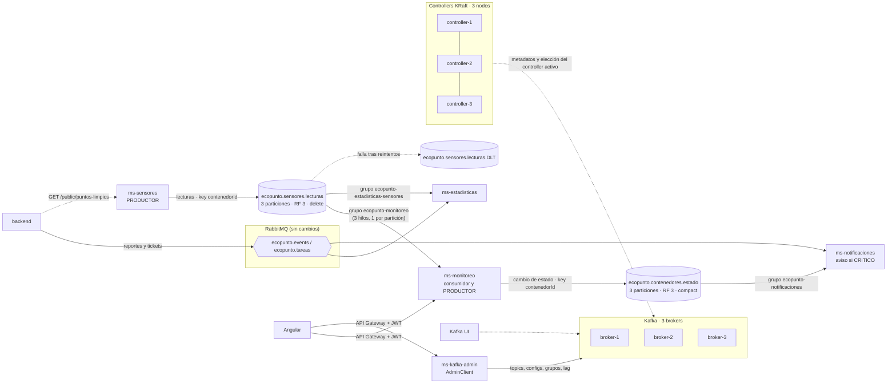

# Streaming con Kafka · Diseño (EP5 encargo / EP6 presentación)

> **Estado:** diseño propuesto, pendiente de implementación. Nada de este documento está construido ni probado todavía.
>
> EP5 (encargo, 12 %) y EP6 (presentación, 18 %) evalúan **el mismo proyecto**: EP5 revisa el código y EP6 la demo en vivo en AWS.

## 1. Problema

Hoy EcoPunto se entera de que un contenedor está lleno **cuando un vecino lo reporta**: llega al punto limpio, no puede depositar y crea un reporte. Es reactivo y depende de que alguien se tome la molestia.

La propuesta es instalar **sensores de llenado** en los contenedores de cada punto limpio (uno por material) y procesar sus lecturas en tiempo real, para anticipar el problema antes de que llegue el reporte.

## 2. Por qué Kafka y no RabbitMQ ni HTTP

| Necesidad | HTTP | Cola RabbitMQ | Kafka |
|---|---|---|---|
| Flujo continuo de lecturas, muchas por minuto | Una llamada por lectura, acoplada al receptor | Sirve, pero cada mensaje se borra al consumirse | Log retenido, pensado para alto volumen |
| Varias responsabilidades leen los **mismos** eventos | El productor tendría que llamar a cada una | Una cola por consumidor y copias del mensaje | Cada consumer group lee el topic de forma independiente |
| Reconstruir una vista después de una caída o con un consumidor nuevo | No hay historia | El mensaje consumido ya no existe | Se relee desde un offset o desde un topic compactado |
| Orden de las lecturas de un mismo contenedor | — | No garantizado con varios consumidores | Garantizado por partición usando la key |

**RabbitMQ se queda donde ya funciona:** reportes, notificaciones de reportes, estadísticas de reportes y tickets. Son *órdenes de trabajo* que se procesan una vez, con ACK y DLQ. Kafka entra solo para el flujo nuevo de telemetría. **No se migra nada de RabbitMQ.**

## 3. Arquitectura



`ms-estadisticas` y `ms-notificaciones` muestran la convivencia: consumen de RabbitMQ (como hoy) y de Kafka, con listeners y configuración separados.

## 4. Infraestructura (`docker-compose.kafka.yml`)

**KRaft en vez de ZooKeeper, acordado con el docente.** La pauta pide 3 nodos ZooKeeper y 3 brokers. Kafka 4.0 eliminó ZooKeeper y lo reemplazó por KRaft, donde un quórum de *controllers* guarda los metadatos. Se mantiene la misma estructura: 3 nodos de coordinación y 3 de datos. Solo cambia la herramienta.

| Servicio | Imagen | Rol |
|---|---|---|
| `kafka-controller-1..3` | `apache/kafka:4.1.2` (`process.roles=controller`) | Quórum Raft de metadatos: qué topics existen, qué broker lidera cada partición y qué réplicas están al día. Uno es el controller activo; con 3 nodos sobrevive a la caída de 1, porque necesita mayoría (2 de 3). Es el rol que antes cumplía ZooKeeper |
| `kafka-broker-1..3` | `apache/kafka:4.1.2` (`process.roles=broker`, IDs 4–6) | Guardan las particiones: cada una tiene un líder y 2 réplicas en brokers distintos |
| `kafka-init` | `apache/kafka:4.1.2` | Se ejecuta una vez y crea los topics con la configuración declarada en el Compose (`infra/kafka/crear-topics.sh`, `--if-not-exists`) |
| `kafka-ui` | `ghcr.io/kafbat/kafka-ui:v1.5.0`, puerto 8089, con login | Administración visual de brokers, topics, particiones, mensajes y grupos |

Los puertos de los brokers **no se exponen a internet**; los microservicios llegan por la red interna `ecopunto-net`. Solo Kafka UI se publica, con usuario y contraseña.

**Tolerancia a fallos comprobada en local:** con `replication.factor=3` y `min.insync.replicas=2`, al detener `kafka-broker-2` la partición 2 cambió de líder (del 5 al 6), el ISR bajó a 2 réplicas y una escritura con `acks=all` se aceptó igual. Al volver el broker, las réplicas se pusieron al día y el ISR regresó a 3.

## 5. Topics

| Campo | `ecopunto.sensores.lecturas` | `ecopunto.contenedores.estado` | `ecopunto.sensores.lecturas.DLT` |
|---|---|---|---|
| **Propósito** | Cada lectura de un sensor: un hecho que no se modifica | Último estado conocido de cada contenedor | Lecturas que no se pudieron procesar |
| **Productor** | ms-sensores | ms-monitoreo | Error handler de ms-monitoreo |
| **Consumidores** | ms-monitoreo, ms-estadisticas | ms-notificaciones | Revisión manual (Kafka UI) |
| **Key** | `contenedorId` (ej. `PL-1-VIDRIO`) | `contenedorId` | La original |
| **Particiones** | 3: paralelismo de hasta 3 consumidores por grupo | 3: la misma key cae en la misma partición en ambos topics | 3 |
| **Replication factor** | 3, una réplica por broker | 3 | 3 |
| **`min.insync.replicas`** | 2: con `acks=all` se tolera la caída de 1 broker sin perder escrituras confirmadas | 2 | 2 |
| **`retention.ms`** | `604800000` (7 días): alcanza para releer una semana | No aplica para borrar por tiempo, porque la limpieza es por compactación | `1209600000` (14 días): tiempo para revisar los errores |
| **`retention.bytes`** | `104857600` (100 MB por partición) | `-1` | `52428800` (50 MB por partición) |
| **`cleanup.policy`** | `delete`: cada lectura es historia | `compact`: solo interesa el último estado de cada key | `delete` |

Los dos topics principales (3 particiones y 3 réplicas cada uno) son los que pide mostrar la EP6 en Kafka UI. El DLT es un tercer topic de apoyo para el manejo de errores.

## 6. Contratos de los eventos (DTO + `JsonSerializer`)

**`LecturaSensorEvent`** (`ecopunto.sensores.lecturas`):

```json
{
  "lecturaId": "6f1c2d…",
  "contenedorId": "PL-1-VIDRIO",
  "puntoLimpioId": 1,
  "material": "VIDRIO",
  "nivelLlenado": 72.5,
  "medidoEn": "2026-11-24T14:03:10Z"
}
```

| Campo | Para qué sirve |
|---|---|
| `lecturaId` | Idempotencia: si una lectura llega dos veces, no se cuenta dos veces |
| `contenedorId` | Key de partición y orden por contenedor |
| `puntoLimpioId`, `material` | Agrupar por punto limpio sin consultar otro servicio |
| `nivelLlenado` | Dato medido, de 0 a 100 |
| `medidoEn` | Momento de la medición, distinto del momento de llegada |

**`EstadoContenedorEvent`** (`ecopunto.contenedores.estado`):

```json
{
  "contenedorId": "PL-1-VIDRIO",
  "puntoLimpioId": 1,
  "material": "VIDRIO",
  "nivelActual": 91.2,
  "nivelPromedio": 88.4,
  "estadoAnterior": "ALERTA",
  "estado": "CRITICO",
  "actualizadoEn": "2026-11-24T14:03:11Z"
}
```

Estados: `NORMAL` (< 75 %), `ALERTA` (75–90 %) y `CRITICO` (≥ 90 %). ms-monitoreo publica **solo cuando el estado cambia**, así ms-notificaciones reacciona una vez por transición y no en cada lectura.

## 7. Consumidores y consumer groups

| Servicio | Consumer group | Topic | Responsabilidad |
|---|---|---|---|
| ms-monitoreo | `ecopunto-monitoreo` | lecturas | Calcular el estado de cada contenedor (promedio de las últimas lecturas) y guardarlo; expone `GET /api/monitoreo/contenedores` |
| ms-estadisticas | `ecopunto-estadisticas-sensores` | lecturas | Lecturas por punto limpio y nivel máximo del día; se suma a `GET /api/estadisticas` |
| ms-notificaciones | `ecopunto-notificaciones-sensores` | estado | Aviso cuando un contenedor pasa a `CRITICO` |

**Dos usos de los consumer groups:**
- **Repartir carga dentro de un grupo:** `ecopunto-monitoreo` usa `concurrency: 3`, un hilo por partición. Si se levanta una segunda instancia, Kafka rebalancea las particiones entre ambas.
- **Responsabilidades independientes:** monitoreo y estadísticas leen el mismo topic con grupos distintos. Cada uno tiene sus offsets y su lag.

Cada `@KafkaListener` solo valida el DTO y delega en un servicio de dominio. La configuración del cliente (bootstrap servers, serializers, `acks`, grupos) vive en `application.yml` y en una clase `KafkaConfig`.

## 8. Manejo de errores

| Caso | Ejemplo | Tratamiento |
|---|---|---|
| JSON malformado | El payload no es un `LecturaSensorEvent` | `ErrorHandlingDeserializer`: no rompe el listener y la lectura va directo al DLT |
| Payload inválido | `nivelLlenado` = 140 o sin `contenedorId` | Validación del DTO, se marca como **no reintentable** y va al DLT con el motivo |
| Error transitorio | Base de datos caída | `DefaultErrorHandler` con espera creciente (3 intentos) y luego DLT |
| Duplicado | Misma `lecturaId` dos veces | Se ignora por idempotencia |

Cada fallo se registra en el log con `topic`, `partition`, `offset`, `key` y motivo. El DLT conserva los headers de origen, así se sabe de dónde vino cada lectura.

## 9. Microservicio administrador `ms-kafka-admin`

API REST sobre `AdminClient`, protegida con el rol `ADMIN` igual que `ms-rabbit-admin`:

| Método | Ruta | Acción |
|---|---|---|
| `GET` | `/api/kafka-admin/topics` | Listar topics con particiones y réplicas |
| `GET` | `/api/kafka-admin/topics/{nombre}` | Detalle: líder y réplicas por partición y configuración |
| `POST` | `/api/kafka-admin/topics` | Crear un topic con particiones, RF y configs |
| `PATCH` | `/api/kafka-admin/topics/{nombre}/config` | Modificar `retention.ms`, `retention.bytes`, `cleanup.policy`, etc. |
| `POST` | `/api/kafka-admin/topics/{nombre}/particiones` | Aumentar particiones |
| `DELETE` | `/api/kafka-admin/topics/{nombre}` | Eliminar un topic; los topics del sistema quedan protegidos |
| `GET` | `/api/kafka-admin/grupos` | Listar consumer groups |
| `GET` | `/api/kafka-admin/grupos/{id}` | Offsets y lag por partición |

Las validaciones siguen el estilo de `ms-rabbit-admin`: nombre válido, particiones ≥ 1 y RF ≤ número de brokers. Además, el script `deploy/kafka-admin.sh` hace lo mismo por CLI, para mostrar una operación reproducible sin el frontend.

## 10. Frontend

- **Monitoreo** (rol `ENCARGADO`): tabla de contenedores con nivel, estado coloreado y última actualización, que se refresca sola. En la demo se ve el cambio a `CRITICO` al llegar nuevas lecturas.
- **Administrar Kafka** (rol `ADMIN`): topics, configuración y grupos con su lag, usando `ms-kafka-admin`.

## 11. Despliegue y memoria

Misma EC2 del backend, que pasa de `t3.medium` a **`t3.large` (8 GB)**:

| Servicios nuevos | Memoria aproximada |
|---|---|
| 3 controllers KRaft (heap 192 MB) | 0,65 GB (medido en local) |
| 3 brokers (heap 384 MB) | 0,8 GB en reposo (medido), hasta ~1,2 GB con carga |
| Kafka UI | 0,25 GB (medido) |
| ms-sensores, ms-monitoreo, ms-kafka-admin | 0,9 GB |

Son unos 3 GB que se suman a los 2,5 GB actuales, cerca de 5,5 GB de 8. Los 3 brokers en la misma máquina demuestran la replicación y la conmutación de líder, pero no protegen ante la caída de la EC2 completa. Eso se explica como limitación del entorno.

## 12. Fuera de alcance

- **Puente de alertas críticas a tickets de RabbitMQ:** obliga a cambiar `ms-tickets`, que exige un `reporteId` único. Queda como mejora si sobra tiempo; la reacción automática se demuestra con el aviso de ms-notificaciones.
- **Kafka Streams:** se descartó porque la pauta evalúa `@KafkaListener` y manejo de errores, y un listener lo cubre con menos riesgo.
